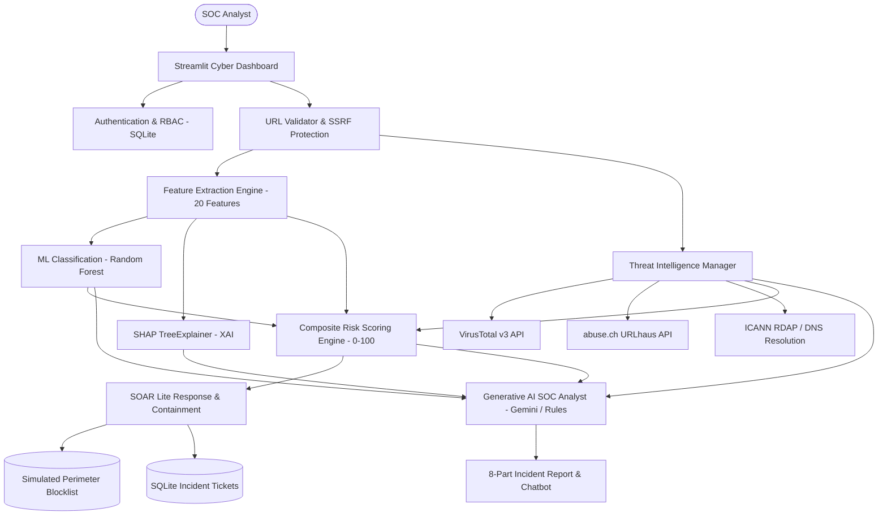

# 🛡️ AI Phishing & Malicious URL Triage Dashboard (SOAR Lite)

> **An enterprise-grade, AI-powered cybersecurity Security Operations Center (SOC) analyst assistant for phishing detection, malicious URL triage, explainable AI diagnostics (SHAP), threat intelligence correlation, and automated incident response.**

---

## 📌 Executive Summary & Project Overview

Modern Security Operations Centers (SOCs) are overwhelmed by thousands of suspicious alert URLs generated daily by email security gateways, endpoint detection & response (EDR) agents, and network firewalls. Manual investigation is slow, error-prone, and unsustainable.

**AI Phishing & Malicious URL Triage Dashboard (SOAR Lite)** functions as an autonomous, lightweight SOC Analyst assistant. It accepts single or bulk URLs, performs deep structural and lexical feature extraction, applies Machine Learning classification to detect threats, explains verdicts using SHAP (Explainable AI), enriches telemetry across multi-vendor threat intelligence feeds (VirusTotal, abuse.ch URLhaus, ICANN RDAP), and triggers automated containment playbooks via a local simulated blocklist.

### Key Capabilities
- 🤖 **Multi-Class Machine Learning Classification**: Classifies URLs into `Benign`, `Phishing`, `Malicious`, and `Suspicious`.
- 🧠 **Explainable AI (SHAP)**: Provides interactive waterfall and feature importance charts detailing *why* a link was flagged, alongside plain-language analyst narratives.
- 🌐 **Multi-Source Threat Intelligence**: Enriches URLs with VirusTotal vendor statistics, abuse.ch URLhaus malware payloads, WHOIS/RDAP registrar data, domain age, and DNS A-records.
- ⚖️ **0–100 Composite Risk Scoring**: Transparently weights ML inference, lexical heuristics, threat vendor consensus, and domain age into standard SOC severity tiers (`Low`, `Moderate`, `Suspicious`, `High`, `Critical`).
- 🤖 **Generative AI Security Analyst**: Compiles an 8-section SOC Incident Report (Executive Summary, Threat Explanation, Indicators, Attack Type, Risk Assessment, Security Actions, IR Steps, Prevention) using Google Gemini or a deterministic fallback reasoning engine.
- ⚡ **SOAR Lite Automation**: Orchestrates tiered playbooks and automated local simulated perimeter blocklisting for critical threats.
- 📁 **High-Throughput Bulk Triage**: Ingests CSV files or pasted URL lists with automatic column detection, progress bars, and CSV export.
- 🔐 **Zero-Trust Security & Authentication**: Role-based access control with secure bcrypt/PBKDF2 salted password hashing, SSRF protection against private IP ranges, and safe URL defanging (`hxxps://evil[.]com`).

---

## 🏛️ System Architecture



---

## 🛠️ Technology Stack

| Layer | Technologies |
| :--- | :--- |
| **Frontend / Dashboard** | Streamlit 1.30+, Custom Glassmorphic Dark Cybersecurity CSS, Plotly 5.18+ |
| **Machine Learning** | Scikit-learn, Random Forest Classifier, Gradient Boosting |
| **Explainable AI (XAI)** | SHAP (TreeExplainer, Waterfall plots, Feature Importance) |
| **Threat Intelligence** | VirusTotal v3 REST API, abuse.ch URLhaus API, ICANN RDAP, Python Socket DNS |
| **Generative AI** | Google Gemini API (`gemini-1.5-flash`) / Deterministic SOC Analyst Reasoning Engine |
| **Database & Auth** | SQLite 3, bcrypt / PBKDF2-HMAC-SHA256, Python UUID |
| **Security Controls** | SSRF subnet filters, RFC 1918 blocking, URL defanging (`hxxp://`) |
| **Testing** | Pytest 7.4+, Automated Test Suite |

---

## 🔬 Extracted URL Security Features (20 Features)

The feature extraction engine (`modules/feature_extraction.py`) analyzes 20 lexical, structural, and heuristic parameters:

1. `url_length`: Overall character count of the URL.
2. `domain_length`: Character length of the domain/FQDN.
3. `num_dots`: Frequency of `.` in URL.
4. `num_hyphens`: Frequency of `-` (frequently used in typosquatting).
5. `num_underscores`: Frequency of `_`.
6. `num_digits`: Total numerical digits.
7. `num_special_chars`: Count of non-alphanumeric punctuation.
8. `num_subdomains`: Depth of subdomain labels (e.g. `login.secure.bank.com`).
9. `is_ip_address`: Boolean indicator if host is a raw IPv4/IPv6 literal.
10. `has_https`: Boolean indicator for TLS/HTTPS protocol.
11. `has_suspicious_keywords`: Presence of authentication/billing lures (`login`, `verify`, `banking`, `wallet`, etc.).
12. `is_shortened`: Detection of known shortening proxies (`bit.ly`, `tinyurl.com`, `t.co`, etc.).
13. `has_at_symbol`: Detection of `@` character (used to obscure real destinations).
14. `has_unusual_port`: Presence of non-standard ports (outside 80/443).
15. `has_encoded_chars`: Detection of `%XX` URL hexadecimal encoding.
16. `excessive_redirect_signs`: Open redirect parameters (`redirect=`, `url=`, `dest=`).
17. `suspicious_tld`: Untrusted/high-abuse TLDs (`.xyz`, `.top`, `.icu`, `.buzz`, `.cam`, etc.).
18. `domain_entropy`: Shannon entropy score of hostname (detects DGA domains).
19. `brand_impersonation`: Deceptive presence of major brands (`paypal`, `chase`, `google`, etc.) outside their authentic apex domain.
20. `suspicious_query_params`: Presence of credential or session tokens in query strings.

---

## ⚡ Risk Scoring Methodology

The composite score is calculated on a normalized scale from **0 to 100**:

$$\text{Composite Score} = (w_{\text{ml}} \times S_{\text{ml}}) + (w_{\text{heuristics}} \times S_{\text{heuristics}}) + (w_{\text{ti}} \times S_{\text{ti}}) + (w_{\text{domain}} \times S_{\text{domain}})$$

Default calibrated weights:
- **Machine Learning Inference ($w_{\text{ml}}$):** 40%
- **Heuristic Indicators ($w_{\text{heuristics}}$):** 25%
- **Threat Intelligence Consensus ($w_{\text{ti}}$):** 25%
- **Domain Age & Reputation ($w_{\text{domain}}$):** 10%

### Severity Tiers & Automated SOAR Actions

| Score Range | Severity Tier | SOAR Playbook | Recommended Response Actions |
| :--- | :--- | :--- | :--- |
| **0 – 20** | **Low Risk** | `PLAYBOOK-LOW-01` | Log transaction, maintain standard perimeter monitoring. |
| **21 – 40** | **Moderate Risk** | `PLAYBOOK-MOD-02` | Verify registrar credentials, monitor domain reputation. |
| **41 – 60** | **Suspicious** | `PLAYBOOK-SUSP-03` | Flag for Tier-2 SOC review, inspect redirect parameters. |
| **61 – 80** | **High Risk** | `PLAYBOOK-HIGH-03` | Enforce simulated blocklist quarantine, alert SOC team, create incident ticket. |
| **81 – 100** | **Critical Risk** | `PLAYBOOK-CRIT-04` | Auto-quarantine on blocklist, escalate P1 alert, initiate credential invalidation review. |

---

## 🚀 Installation & Setup

### 1. Prerequisites
- Python 3.10 or 3.11 installed
- Git installed

### 2. Clone Repository & Setup Virtual Environment
```bash
git clone https://github.com/your-username/AI-Phishing-Triage.git
cd AI-Phishing-Triage

# Create and activate virtual environment
python -m venv venv

# Windows:
venv\Scripts\activate

# Linux / macOS:
source venv/bin/activate
```

### 3. Install Dependencies
```bash
pip install -r requirements.txt
```

### 4. Configure Environment Variables
Copy the template configuration file:
```bash
cp .env.example .env
```
Edit `.env` to supply your API keys (optional; full demo/fallback mode runs automatically if keys are omitted):
```env
VIRUSTOTAL_API_KEY=your_virustotal_api_key_here
URLHAUS_API_KEY=your_urlhaus_api_key_here
GEMINI_API_KEY=your_gemini_api_key_here

APP_ENV=development
DATABASE_PATH=data/soar_lite.db
WEIGHT_ML_MODEL=0.40
WEIGHT_HEURISTICS=0.25
WEIGHT_THREAT_INTEL=0.25
WEIGHT_DOMAIN_REPUTATION=0.10
```

### 5. Train & Evaluate Machine Learning Models
```bash
python model/train_model.py
```
This trains Random Forest and Gradient Boosting classifiers on `data/sample_urls.csv`, compares performance, and persists `phishing_model.pkl` and `training_metrics.json`.

### 6. Run the Application
```bash
streamlit run app.py
```
Open your browser to `http://localhost:8501`.

---

## 🔐 Default Evaluation Credentials

The application seeds default accounts for rapid evaluation and testing:

| Username | Password | Assigned Role |
| :--- | :--- | :--- |
| `analyst` | `socAnalyst2026!` | Senior SOC Analyst |
| `admin` | `socAdmin2026!` | SOC Lead |

*(You can also register a new analyst account via the login portal)*

---

## 🧪 Automated Testing

Execute the comprehensive test suite:
```bash
pytest tests -v
```

Tests cover:
- URL validation, SSRF subnet filters, and defanging (`tests/test_url_validator.py`)
- 20-feature extraction and Shannon entropy computation (`tests/test_feature_extraction.py`)
- Machine Learning inference and batch predictions (`tests/test_ml_prediction.py`)
- Composite risk scoring engine and weighting (`tests/test_risk_scoring.py`)
- SQLite database CRUD, incident lifecycles, and blocklists (`tests/test_database.py`)
- Password hashing, registration, and authentication verification (`tests/test_authentication.py`)

---

## 📁 Repository Structure

```
AI-Phishing-Triage/
│
├── app.py                      # Main entry point & authentication portal
├── requirements.txt            # Python dependencies
├── README.md                   # Complete architectural documentation
├── .env.example                # Configuration template
├── .gitignore                  # Git ignore rules
│
├── pages/                      # Multi-page Streamlit application
│   ├── 1_Dashboard.py          # Overview metrics, charts, & triage table
│   ├── 2_URL_Scanner.py        # Deep single-URL triage, SHAP, & AI reports
│   ├── 3_Bulk_Analysis.py      # Batch CSV ingestion, filtering, & export
│   ├── 4_Threat_Intelligence.py# Multi-source threat intel explorer
│   ├── 5_Incident_Management.py# SOAR incident management center
│   ├── 6_AI_Analyst.py         # Grounded SOC conversational assistant
│   └── 7_Settings.py           # API status, model metrics, & blocklist
│
├── modules/                    # Reusable core modules
│   ├── __init__.py
│   ├── authentication.py       # Password hashing & session state
│   ├── database.py             # SQLite parameterized database layer
│   ├── feature_extraction.py   # 20 lexical & structural security features
│   ├── url_validator.py        # Input sanitation, SSRF filters, defanging
│   ├── ml_model.py             # Classifier loader & inference engine
│   ├── shap_explainer.py       # SHAP TreeExplainer & Plotly visualizations
│   ├── virustotal.py           # VirusTotal v3 REST API integration
│   ├── urlhaus.py              # abuse.ch URLhaus malware intelligence
│   ├── domain_intelligence.py  # WHOIS / RDAP & DNS resolution
│   ├── risk_scoring.py         # 0-100 composite risk scoring engine
│   ├── ai_analyst.py           # Generative AI SOC analyst & report generator
│   ├── incident_manager.py     # SOAR playbooks & local containment
│   ├── report_generator.py     # Markdown & JSON incident report exporter
│   └── ui_common.py            # Custom CSS & reusable UI components
│
├── model/                      # ML pipeline artifacts
│   ├── train_model.py          # Reproducible model training & comparison
│   ├── phishing_model.pkl      # Serialized champion model (Random Forest)
│   ├── feature_columns.json    # Exact feature column ordering
│   └── training_metrics.json   # Real evaluation metrics & confusion matrix
│
├── data/                       # Datasets & local storage
│   ├── sample_urls.csv         # Labeled demonstration dataset
│   └── soar_lite.db            # SQLite database (auto-generated)
│
├── assets/                     # Styles and media
│   └── styles.css              # Custom cybersecurity theme styling
│
└── tests/                      # Pytest automated test suite
    ├── __init__.py
    ├── test_authentication.py
    ├── test_database.py
    ├── test_feature_extraction.py
    ├── test_ml_prediction.py
    ├── test_risk_scoring.py
    └── test_url_validator.py
```

---

## 🔒 Security & Privacy by Design

- **SSRF Mitigation**: Rejects private IP ranges (RFC 1918), loopback addresses (`127.0.0.1`), link-local IPs (`169.254.0.0/16`), and internal metadata hostnames before any network lookups.
- **Safe URL Defanging**: Automatically transforms hostile URLs into safe text representations (`hxxps://bad[.]com`) across all UI elements, preventing accidental browser navigation.
- **SQL Injection Prevention**: All SQLite queries use strict parameterized queries (`?` placeholders).
- **Credential Protection**: Passwords are never stored in plaintext; salted `bcrypt` with work factor 12 (or PBKDF2 fallback) is enforced.
- **Simulated Containment**: Blocklist operations are strictly simulated locally within SQLite to protect production network infrastructure.

---

## 📜 Dataset Attribution & Limitations

- **Sample Dataset**: The bundled dataset `data/sample_urls.csv` contains labeled demonstration URLs across `Benign`, `Phishing`, `Malicious`, and `Suspicious` categories sourced from open threat intelligence reports and research benchmarks.
- **Limitations**: Static URL feature analysis does not execute JavaScript inside web pages. Certain multi-stage phishing attacks hiding behind legitimate SaaS reverse proxies (e.g., Cloudflare Workers) require runtime browser sandboxing for full dynamic detonation.
- **Ethical Use**: This tool is designed strictly for authorized cybersecurity defense, threat triage, educational research, and college capstone demonstrations.

---

## 💡 Future Enhancements
- [ ] Integration with Microsoft Sentinel and Splunk SOAR webhooks.
- [ ] Dynamic headless Chromium DOM inspection for hidden iframe detection.
- [ ] TLS certificate transparency log streaming.
- [ ] YARA rule scanning for downloaded payloads.
